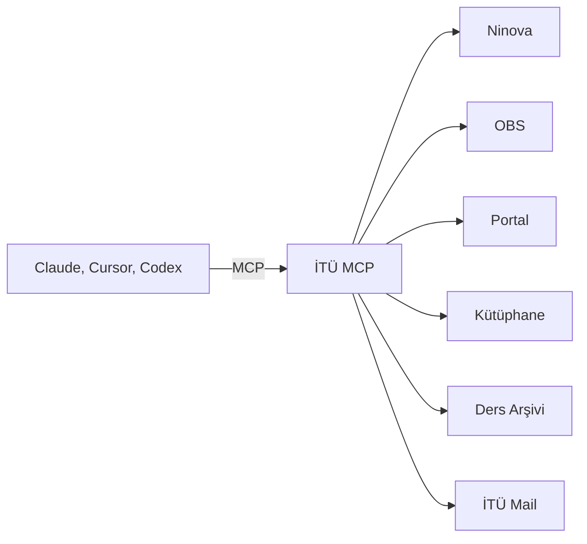

<!-- mcp-name: io.github.yatuk/itu-mcp -->

<div align="center">

  <h1>İTÜ MCP</h1>

  <p><em>Ninova, OBS, Portal, kütüphane ve ders arşivini yapay zeka asistanına bağla. Sonra sadece sor.</em></p>

  <p>
    <a href="CHANGELOG.md"></a>
    <a href="LICENSE"></a>
    <a href="https://github.com/yatuk/itu-mcp"></a>
    <a href="https://yatuk.github.io/mcpradar/"></a>
    <a href="https://modelcontextprotocol.io"></a>
  </p>

  <p>
    <a href="#3-adımda-kur"><strong>Kur</strong></a> ·
    <a href="#neler-sorabilirsin"><strong>Örnekler</strong></a> ·
    <a href="#sık-sorulanlar"><strong>Sık sorulanlar</strong></a> ·
    <a href="docs/advanced.md"><strong>Tüm araçlar</strong></a>
  </p>

  <p>
    
  </p>

  <sub>Sesli ve tam çözünürlüklü hali: <a href="docs/demo.mp4">docs/demo.mp4</a></sub>

</div>

---

## In English

**İTÜ MCP** is an unofficial, open source [Model Context Protocol](https://modelcontextprotocol.io) server for students of Istanbul Technical University (İTÜ). It runs on your own computer and lets an AI assistant such as Claude, ChatGPT, Cursor or Codex read İTÜ's systems for you: the Ninova LMS (courses, assignments, files, announcements), OBS (grades, schedule, registration status, transcript, graduation progress), the student Portal, the library catalog and a public archive of past course offerings.

- Ask in plain language: "what is due this week", "what will my GPA be if I get BB in everything", "which sections of MAT 210E still have seats".
- Read-only by default. The two actions that change something (uploading an assignment, saving a registration draft) ask you for confirmation first.
- Your İTÜ password stays on your machine and is sent only to İTÜ's own login page.
- Install with `pipx install itu-mcp`, or add it to Claude Code as a plugin: `claude plugin marketplace add yatuk/itu-mcp`.

The rest of this page is in Turkish. Setup: [3 adımda kur](#3-adımda-kur). Full tool list: [docs/advanced.md](docs/advanced.md). Security model: [docs/security.md](docs/security.md). This project is not affiliated with İTÜ.

---

## Bu ne işe yarıyor?

Ödev için Ninova'ya, not için OBS'ye, yemek için Portal'a girmek yerine asistanına yazıyorsun, o da gerçek veriyi çekip cevaplıyor.

İTÜ MCP bilgisayarında çalışan küçük bir programdır. Claude, Cursor veya Codex gibi bir asistana İTÜ sistemlerini okuma yeteneği kazandırır. Kod yazmayı bilmen gerekmez, kurup soru sorman yeterli.

| Sen yazarsın | O bakar |
|:---|:---|
| "Bu hafta hangi ödevlerim var?" | Ninova |
| "Vize notlarım açıklandı mı?" | OBS |
| "Bugün yemekte ne var?" | Portal |
| "Bu dersi geçen yıl kim verdi, kaç kişi AA aldı?" | Ders arşivi |
| "Kütüphanede bu kitap var mı?" | Kütüphane kataloğu |
| "Okunmamış maillerimi özetle" | İTÜ Mail |
| "Bu şubede yer açılınca haberim olsun" | Kontenjan takibi |
| "Ders programımı telefonumun takvimine ekle" | Takvim dosyası (.ics) |

> Şifren bilgisayarından çıkmaz. Program yalnızca İTÜ'nün kendi sunucularıyla konuşur.
> İstanbul Teknik Üniversitesi ile resmi bir bağlantısı yoktur.

---

## 3 adımda kur

Python 3.11 veya üstü gerekir. Yüklü değilse [python.org](https://www.python.org/downloads/) adresinden kurabilirsin.

**1. Programı kur**

```bash
pipx install "itu-mcp[keyring]"
```

`pipx` yoksa `pip install --user "itu-mcp[keyring]"` da olur.

**2. Giriş bilgilerini kaydet ve asistanına bağla**

```bash
itu-mcp setup
```

```bash
itu-mcp connect
```

`itu-mcp setup` İTÜ e-postanı ve şifreni sorar. Şifre yazarken ekranda görünmez ve hiçbir dosyaya yazılmaz, işletim sisteminin anahtar zincirine kaydedilir (Windows Kimlik Bilgileri Yöneticisi, macOS Anahtar Zinciri, Linux'ta GNOME Keyring ya da KWallet).

`itu-mcp connect` sunucuyu Claude Desktop, Claude Code ve Cursor ayarlarına şifresiz olarak ekler. Diğer ayarlarına dokunmaz, dosyanın yedeğini alır. Ne yapacağını önce görmek istersen `itu-mcp connect --dry-run` yaz. Tek bir asistan için: `itu-mcp connect claude-desktop` (ya da `claude-code`, `cursor`).

<details>
<summary><strong>Anahtar zinciri istemiyorum ya da Codex kullanıyorum</strong></summary>

<br />

Şifreyi asistanın ayarına elle de yazabilirsin.

**Claude Code**

```bash
claude mcp add itu itu-mcp -e NINOVA_USERNAME=ad.soyad@itu.edu.tr -e NINOVA_PASSWORD=sifren
```

**Codex CLI**

```bash
codex mcp add itu --env NINOVA_USERNAME=ad.soyad@itu.edu.tr --env NINOVA_PASSWORD=sifren -- itu-mcp
```

**Claude Desktop ve Cursor** için hazır ayar dosyaları `examples/` klasöründe. Adım adım anlatım: [docs/installation.md](docs/installation.md).

</details>

**3. Sor**

Asistanı yeniden başlat ve yaz:

```
Ninova'daki derslerimi listele
```

Bir liste geldiyse kurulum tamam.

<details>
<summary><strong>Çalışmadı, ne yapmalıyım?</strong></summary>

<br />

Önce şunu çalıştır:

```bash
itu-mcp doctor
```

Her satır OK, UYARI ya da HATA ile başlar ve OK olmayan satırın altında çözümü yazar. Girişi de denemesi için `itu-mcp doctor --online` yaz.

- Giriş hata veriyorsa kullanıcı adını tam e-posta olarak yazdığından emin ol (`ad.soyad@itu.edu.tr`, yalnızca `ad.soyad` değil).
- Komut bulunamıyorsa terminali kapatıp yeniden aç. `pipx` kurulumdan sonra yeni bir terminal ister.
- Asistan aracı görmüyorsa asistanı tamamen kapatıp açmayı dene.
- Hâlâ olmuyorsa [bir sorun kaydı aç](https://github.com/yatuk/itu-mcp/issues), ekran çıktısını ekle. Şifreni yazma.

</details>

> **Şifre vermek istemiyor musun?** Ders programı, final tarihleri, not dağılımları, ders arşivi, mekik saatleri ve kütüphane kataloğu gibi herkese açık bilgiler şifresiz de çalışır. `itu-mcp setup` adımını atlayıp yalnızca `itu-mcp connect` çalıştırman yeterli.

---

## Neler sorabilirsin?

Aşağıdakiler Claude Code'a yazılmış örnek sorular. Sen kendi cümlelerinle sorabilirsin, hangi aracın çağrılacağını asistan seçer. Çıktılar örnektir, sende kendi verin görünür.

<table>
<tr>
<td width="50%" valign="top">

**Ödev takibi**

```text
> Bu hafta hangi ödevlerimin teslimi var?

● itu · get_upcoming_deadlines

Bu hafta 2 teslimin var:

  BLG 223E  Ödev 3
            Perşembe 23:59, 2 gün kaldı
            Henüz yüklenmemiş

  MAT 210E  Proje raporu
            Pazar 23:59, 5 gün kaldı
            Yüklendi
```

</td>
<td width="50%" valign="top">

**Dersi kim verdi, nasıl geçti?**

```text
> BLG 223E geçen güz nasıl geçmiş?

● itu · archive_grade_distribution

2025-2026 Güz, 176 öğrenci:

  AA   9      CC+  19
  BA+ 12      CC   21
  BB+ 18      FF   38

En kalabalık not FF (38 kişi).
AA alan 9 kişi var.
```

</td>
</tr>
<tr>
<td width="50%" valign="top">

**Kayıt haftası**

```text
> 12469, 12554 ve 12583 CRN'leri
  çakışıyor mu?

● itu · check_course_conflicts

1 çakışma buldum:

  Salı 08:30-10:29
  BLG 223E ile BLG 345E üst üste

12583 (BLG 422E) sorunsuz.
BLG 345E için başka şube arayayım mı?
```

</td>
<td width="50%" valign="top">

**Ön şart kontrolü**

```text
> BLG 335E'yi bu dönem alabilir miyim?

● itu · explain_course_eligibility

Henüz alamazsın.

  Gereken:  BLG 223E (en az DD)
  Durumun:  BLG 223E bu dönem kayıtlı,
            notu açıklanmamış

BLG 223E'yi geçersen gelecek dönem
açılıyor.
```

</td>
</tr>
<tr>
<td width="50%" valign="top">

**Günlük işler**

```text
> Bugün yemekte ne var, mekik kaçta?

● itu · get_cafeteria_menu
● itu · get_shuttle_schedule

Öğle yemeği:
  Mercimek çorbası, tavuk sote,
  pirinç pilavı, sütlaç

Ayazağa'dan sonraki mekik 13:30.
```

</td>
<td width="50%" valign="top">

**Not ve ortalama**

```text
> Bu dönem hepsinden BB alırsam
  ortalamam kaç olur?

● itu · obs_simulate_cumulative_gpa

Şu anki GANO:      2.08
Dönem tahmini:     3.00
Dönem sonu GANO:   2.74

Tekrar aldığın 2 ders eski notun
yerine sayıldı, 1 ders yeni eklendi.

Bu bir tahmin, resmi ortalama
OBS'de açıklanır.
```

</td>
</tr>
</table>

Daha fazla fikir:

- "EEF 211E sınıf dosyalarındaki son PDF'i özetle."
- "Danışmanım kim, staj durumum ne?"
- "Transkriptimi indir."
- "BBB binasında şu an boş derslik var mı?"
- "BLG 223E'yi geçersem hangi dersler açılır?"
- "Mezuniyetime kaç ders kaldı, gelecek dönem hangilerini almalıyım?"
- "Kütüphanede Introduction to Algorithms var mı?"
- "Son okunmamış maillerimi listele, ekindeki PDF'i özetle."

Asistanın `/` menüsünde hazır akışlar da var: `weekly_briefing` (haftalık özet), `plan_next_term` (gelecek dönem planı), `registration_week` (kayıt haftası kontrolü), `check_course_eligibility`, `research_course` ve `gpa_scenario`.

---

## Sık sorulanlar

<details>
<summary><strong>Şifrem nereye gidiyor?</strong></summary>

<br />

Hiçbir yere. Program senin bilgisayarında çalışır ve şifreni yalnızca İTÜ'nün kendi giriş sayfasına gönderir, tıpkı tarayıcının yaptığı gibi. Arada bizim ya da başkasının bir sunucusu yoktur. Kod açık, istersen [kendin bakabilirsin](src/ninova_mcp).

</details>

<details>
<summary><strong>Bu resmi bir İTÜ uygulaması mı?</strong></summary>

<br />

Hayır. Öğrenciler tarafından yazılmış açık kaynak bir projedir, İTÜ ile resmi bağlantısı yoktur. Yalnızca kendi hesabınla kullan.

</details>

<details>
<summary><strong>Hesabımda bir şeyi değiştirebilir mi?</strong></summary>

<br />

Neredeyse her şey yalnızca okur. İki istisna var ve ikisi de senin açık onayın olmadan çalışmaz:

- **Ödev yükleme.** Önce neyi nereye yükleyeceğini gösterir, sen onaylayınca yükler.
- **Kayıt taslağı kaydetme.** Varsayılan olarak kapalıdır. Açsan bile taslaktan ders silinecekse durur ve sana sorar.

İkisinde de, asistanın destekliyorsa, program göndermeden hemen önce sana doğrudan bir onay penceresi açar: hangi dosya, hangi ödev, hangi CRN'ler yazılacak, hangileri taslaktan çıkacak. Asistanın kendi kendine "onaylıyorum" demesi bu pencereyi atlatamaz. Onaylamazsan hiçbir şey gönderilmez.

Ders kaydı yapmaz, ders bırakmaz, mail göndermez.

</details>

<details>
<summary><strong>Verdiği cevaba güvenebilir miyim?</strong></summary>

<br />

Veriyi doğrudan İTÜ sistemlerinden çeker, uydurmaz. Yine de OBS bazı bilgileri hesaba göre farklı döndürebiliyor. Bir veri eksikse araç bunu açıkça söyler. Kayıt, mezuniyet ve not gibi önemli kararlarda son sözü her zaman OBS'nin kendi sayfası söyler.

</details>

<details>
<summary><strong>Hangi asistanlarla çalışıyor?</strong></summary>

<br />

MCP destekleyen her istemciyle: Claude Code, Claude Desktop, Cursor, Codex ve benzerleri. ChatGPT ya da Claude.ai gibi web arayüzleri için uzak sunucu kurulumu gerekir, anlatımı [docs/advanced.md](docs/advanced.md) içinde.

</details>

<details>
<summary><strong>Yer açılınca haber verebilir mi?</strong></summary>

<br />

Kısmen. Dolu bir şubenin CRN'ini izleme listesine ekleyebilirsin (`watch_course_sections`), sonra "izlediğim şubelerde yer açıldı mı" diye sorduğunda son kontrolden bu yana ne değiştiğini söyler. Giriş gerektirmez.

Ama program arka planda çalışmaz ve kendiliğinden bildirim göndermez. Kontenjan yalnızca sen sorduğunda okunur. Düzenli takip istiyorsan asistanında birkaç dakikada bir bu soruyu soran zamanlanmış bir görev kurman gerekir.

</details>

<details>
<summary><strong>Araç sayısı çok fazla, azaltabilir miyim?</strong></summary>

<br />

Evet. Araçlar gruplara ayrılmış durumda ve her aracın tanımı sohbetin başında asistana yüklenir. Kullanmadığın grupları kapatırsan asistan doğru aracı daha kolay seçer.

```bash
NINOVA_TOOLSETS=ninova,obs,archive        # yalnızca bu gruplar açık olsun
NINOVA_DISABLED_TOOLSETS=library,mail     # ya da: bunlar dışında her şey açık olsun
```

Gruplar: `core`, `ninova`, `files`, `obs`, `registration`, `portal`, `planning`, `public`, `campus`, `library`, `archive`, `mail`. İkisini de yazmazsan her şey açık kalır. Hangi grupta ne olduğunu `itu-mcp --list-toolsets` gösterir.

</details>

<details>
<summary><strong>Ücretli mi?</strong></summary>

<br />

Hayır. MIT lisanslı, tamamen ücretsiz. Yalnızca kullandığın asistanın kendi ücreti varsa o geçerlidir.

</details>

---

## Nasıl çalışır?



Asistan bir soru aldığında İTÜ MCP'deki uygun aracı çağırır. Araç ilgili İTÜ sistemine gider, cevabı düzenli bir biçimde geri verir, asistan da bunu sana anlatır. Ninova ve OBS aynı İTÜ girişini kullanır. Şifre gerektirmeyen araçlar şifreni hiç kullanmaz.

<details>
<summary><strong>Tüm araçları göster</strong></summary>

<br />

<table>
  <tr>
    <td align="center" width="20%"><strong>Ninova</strong><br/><sub>giriş gerekir</sub></td>
    <td align="center" width="20%"><strong>OBS ve Portal</strong><br/><sub>giriş gerekir</sub></td>
    <td align="center" width="20%"><strong>Herkese açık</strong><br/><sub>giriş gerekmez</sub></td>
    <td align="center" width="20%"><strong>Planlama ve kütüphane</strong><br/><sub>karma</sub></td>
    <td align="center" width="20%"><strong>Arşiv</strong><br/><sub>giriş gerekmez</sub></td>
  </tr>
  <tr>
    <td valign="top">
      <code>auth_status</code> · <code>list_courses</code><br/>
      <code>get_course_*</code> · <code>sync_all_courses</code><br/>
      <code>get_upcoming_deadlines</code> · <code>search_content</code><br/>
      <code>export_table</code> · <code>read_resource_text</code> · <code>submit_assignment</code>
    </td>
    <td valign="top">
      <code>obs_auth_status</code> · <code>obs_get_profile</code><br/>
      <code>obs_list_registered_courses</code><br/>
      <code>obs_get_registration_draft</code> · <code>obs_save_registration_draft</code><br/>
      <code>obs_get_elective_group</code> · <code>obs_validate_registration_plan</code><br/>
      <code>obs_get_course_grades</code> · <code>obs_get_attendance</code><br/>
      <code>obs_get_advisor</code> · <code>obs_download_transcript</code><br/>
      <code>get_cafeteria_menu</code> · <code>obs_get_notifications</code><br/>
      <code>obs_get_help_tickets</code> · <code>get_help_ticket</code>
    </td>
    <td valign="top">
      <code>get_public_course_schedule</code> · <code>get_public_exam_schedule</code><br/>
      <code>obs_get_grade_distribution</code><br/>
      <code>search_itu_directory</code> · <code>search_campus_locations</code><br/>
      <code>get_shuttle_schedule</code> · <code>get_sports_facility_hours</code><br/>
      <code>get_itu_announcements</code> · <code>get_academic_calendar</code><br/>
      <code>watch_course_sections</code> · <code>check_watched_course_sections</code><br/>
      <code>export_course_schedule_ics</code> · <code>export_exam_schedule_ics</code>
    </td>
    <td valign="top">
      <code>obs_calculate_gpa</code> · <code>obs_simulate_cumulative_gpa</code> · <code>calculate_target_gpa</code><br/>
      <code>estimate_relative_grade</code> · <code>check_course_conflicts</code><br/>
      <code>find_open_course_sections</code> · <code>find_empty_classrooms</code><br/>
      <code>build_degree_plan</code> · <code>library_*</code>
    </td>
    <td valign="top">
      <code>archive_who_taught</code> · <code>archive_course_history</code><br/>
      <code>archive_fill_rate</code> · <code>archive_term_sections</code><br/>
      <code>archive_search_courses</code> · <code>plan_remaining_courses</code><br/>
      <code>archive_grade_distribution</code> · <code>archive_course_catalog</code><br/>
      <code>archive_course_unlocks</code> · <code>archive_search_sections</code><br/>
      <code>archive_exam_schedule</code> · <code>archive_status</code>
    </td>
  </tr>
  <tr>
    <td colspan="5" align="center"><strong>İTÜ Mail (salt okunur):</strong> <code>mail_status</code> · <code>mail_list_inbox</code> · <code>mail_get_message</code> · <code>mail_get_attachment</code></td>
  </tr>
</table>

Her aracın ne yaptığı, parametreleri ve sınırları: [docs/advanced.md](docs/advanced.md). Kayıt planlama araçları için [docs/registration-planning.md](docs/registration-planning.md), not dağılımları için [docs/grade-distribution.md](docs/grade-distribution.md).

</details>

<details>
<summary><strong>Ayarlar (isteğe bağlı)</strong></summary>

<br />

Çoğu kişinin hiçbir ayara dokunması gerekmez. İstersen şunları ortam değişkeni olarak verebilirsin:

```bash
NINOVA_SESSION_PERSIST=1            # girişi hatırla (varsayılan açık)
NINOVA_ALLOW_UPLOADS=1              # ödev yüklemeye izin ver (0 yaparsan kapanır)
NINOVA_OBS_REGISTRATION_WRITES=1    # kayıt taslağı kaydetmeyi aç (varsayılan kapalı)
NINOVA_REQUIRE_ELICITATION=1        # onay penceresi gösteremeyen asistanlarda yazma işlemini reddet
NINOVA_ALLOW_SENSITIVE_OUTPUT=1     # TCKN, telefon, adres ve adların gizlenmeden dönmesine izin ver (varsayılan kapalı)
NINOVA_EXTRA_READ_DIRS=...          # asistanın okuyabileceği ek klasörler (tam yol)
NINOVA_EXTRA_DOWNLOAD_DIRS=...      # indirmelerin yazılabileceği ek klasörler (tam yol)
NINOVA_MAX_DOWNLOAD_MB=200          # tek indirme için boyut sınırı
NINOVA_TOOLSETS=ninova,obs,archive  # yalnızca bu araç gruplarını aç
NINOVA_TRACKING_MAX_AGE_SECONDS=43200  # teslim kaydı bu süreden eskiyse yeniden oku (varsayılan 12 saat)
NINOVA_MAIL_USERNAME=...            # mail için ayrı kullanıcı adı
NINOVA_MAIL_PASSWORD=...            # mail için ayrı şifre
```

`.env` dosyası yalnızca sunucunun başlatıldığı klasörde aranır, üst klasörlere bakılmaz. Başka bir dosya için `NINOVA_ENV_FILE` değişkenine tam yolu yaz. O klasördeki `.env` kullanıcı adı ve şifre gibi değerleri verebilir ama adres, sunucu, klasör ve yazma izni gibi güvenlikle ilgili ayarları değiştiremez. Bunları asistanının `env` bloğunda ya da `NINOVA_ENV_FILE` ile gösterdiğin dosyada ver.

Tam liste `.env.example` dosyasında ve [docs/advanced.md](docs/advanced.md) içinde. Kütüphane kataloğu ve proxy ayarı için [docs/library-catalog.md](docs/library-catalog.md).

</details>

---

## Güvenlik

| Yap | Yapma |
|---|---|
| Yalnızca **kendi** İTÜ hesabını kullan | `.env` dosyanı ya da şifreni kimseyle paylaşma |
| Ödev yüklemeden önce önizlemeyi oku | Asistana "sormadan yükle" deme |
| Duyuru ve mail metinlerini **veri** olarak gör | Bir duyurunun içindeki "şunu yap" cümlesine asistanın uymasına izin verme |
| İndirilen dosyaları `~/.ninova_state/downloads` altında tut, başka klasör gerekiyorsa `NINOVA_EXTRA_DOWNLOAD_DIRS` ile sen belirle | Asistanın dosyayı istediği klasöre kaydetmesine ya da bilgisayarındaki herhangi bir dosyayı okumasına izin verme |
| Uzak sunucu kuruyorsan uzun ve rastgele bir `NINOVA_REMOTE_API_KEY` ile `NINOVA_ALLOWED_HOSTS` ayarla | `NINOVA_REMOTE_ALLOW_UNAUTHENTICATED=1` ile sunucuyu anahtarsız internete açma |

Bilmen gereken sınırlar:

- Adres alan araçlar (`read_page`, `download_resource` ve benzerleri) yalnızca `ninova.itu.edu.tr` adreslerini kabul eder. OBS, Portal ve yardım talepleri için kendi araçları var.
- OBS profil araçları TCKN ve telefonu, yardım talebi aracı kişi adlarını gizler. Asistan istese bile bunlar ancak sen `NINOVA_ALLOW_SENSITIVE_OUTPUT=1` ayarladıysan görünür.
- İTÜ Mail araçları yalnızca `imap.itu.edu.tr` sunucusuna, 993 numaralı porttan bağlanır.
- Uzak HTTP sunucusu (`itu-mcp-remote`) `127.0.0.1` dışında bir adrese bağlanıyorsa (Docker imajı dahil) `NINOVA_REMOTE_API_KEY` ve `NINOVA_ALLOWED_HOSTS` ya da `NINOVA_PUBLIC_BASE_URL` verilmeden çalışmaz, eksik değişkeni yazıp kapanır. Yerelde anahtar vermezsen her açılışta rastgele bir anahtar üretir ve bir kez ekrana yazar.

Ayrıntılar: [docs/security.md](docs/security.md) ve [docs/advanced.md](docs/advanced.md).

---

## Gizlilik (Privacy Policy)

İTÜ MCP senin bilgisayarında çalışır. Projenin bir sunucusu, hesabı ya da veri tabanı yoktur.

- **Toplanan veri:** yok. Proje geliştiricisine hiçbir veri gönderilmez, kullanım ölçümü (telemetri) yapılmaz.
- **Kullanım ve saklama:** İTÜ kullanıcı adın ve şifren yalnızca senin verdiğin ortam değişkenlerinden okunur ve yalnızca İTÜ'nün giriş sayfasına gönderilir. Oturum çerezleri, takip kayıtları ve indirdiğin dosyalar bilgisayarında `~/.ninova_state` klasöründe tutulur.
- **Üçüncü taraflarla paylaşım:** araçların okuduğu veri, kullandığın yapay zeka asistanına (Claude, ChatGPT ve benzeri) cevap olarak iletilir; o verinin nasıl işlendiği asistan sağlayıcısının politikasına bağlıdır. Sunucu yalnızca İTÜ'nün kendi sitelerine ve herkese açık iki veri kaynağına istek atar: ders arşivi (`itu-ders.com`) ve ön şart karşılaştırması için bir topluluk veri seti (`raw.githubusercontent.com/itu-helper`). Bu ikisine hesabınla ilgili hiçbir bilgi gönderilmez, yalnızca ders kodları sorgulanır.
- **Saklama süresi:** yerel dosyalar sen silene kadar durur. `~/.ninova_state` klasörünü silmek her şeyi kaldırır.
- **İletişim:** [GitHub üzerinden sorun kaydı](https://github.com/yatuk/itu-mcp/issues) ya da güvenlik konuları için [özel bildirim](https://github.com/yatuk/itu-mcp/security/advisories/new).

In short (English): the server runs locally, collects nothing, sends your İTÜ credentials only to İTÜ's login page, stores session cookies and downloads only under `~/.ninova_state` on your machine, and has no telemetry. Tool results are passed to the AI assistant you use.

---

## Geliştirme

Katkıya açık. Bir hata bulduysan ya da bir fikrin varsa [sorun kaydı aç](https://github.com/yatuk/itu-mcp/issues).

```bash
git clone https://github.com/yatuk/itu-mcp.git
cd itu-mcp
python -m venv .venv
# Windows: .venv\Scripts\activate
source .venv/bin/activate
pip install -e ".[playwright]"
python -m pytest tests/ -q
python -m ruff check src/ tests/
```

| Kaynak | Bağlantı |
|---|---|
| Kurulum | [docs/installation.md](docs/installation.md) |
| Tüm araçlar ve gelişmiş kullanım | [docs/advanced.md](docs/advanced.md) |
| Güvenlik | [docs/security.md](docs/security.md) |
| Değişiklik günlüğü | [CHANGELOG.md](CHANGELOG.md) |

---

## Teşekkür

Bu proje, [**Hikmet Gultekin**](https://github.com/hikmedit)'in yazdığı orijinal **[ninova-mcp](https://github.com/hikmedit/ninova-mcp)** üzerine kuruldu. İlk açık kaynak, kimlik bilgisiyle çalışan İTÜ Ninova MCP sunucusudur.

[**tzi4**](https://github.com/tzi4) salt okunur İTÜ Mail araçlarını, kayıt planlama ve not dağılımı araçlarını, yardım talebi detaylarını ve OBS tarafındaki pek çok düzeltmeyi katkı olarak ekledi. Teşekkürler.

---

## Lisans

[MIT](LICENSE). İstanbul Teknik Üniversitesi ile resmi bağlantısı yoktur.

<br />

<div align="center">
  <sub><a href="https://github.com/yatuk">yatuk</a> tarafından · <a href="https://github.com/yatuk/itu-mcp">GitHub</a></sub>
</div>
